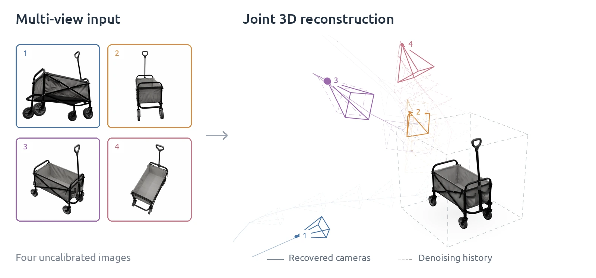

<div align="center">
<h1>GenSfM</h1>
<h3>Generative Structure from Motion with Native 3D Diffusion</h3>
<p><strong>NeurIPS 2026</strong></p>
<p>Haobin Duan<sup>1,2,&#42;</sup> · Binbin Huang<sup>1,2,&#42;</sup> · Mochu Xiang<sup>1,2</sup> · Yiqun Zhao<sup>1,2</sup><br>Zibo Zhao<sup>3</sup> · Yi Ma<sup>1,2</sup> · Shenghua Gao<sup>1,2,†</sup></p>
<p><sup>1</sup> The University of Hong Kong &nbsp; <sup>2</sup> Transengram &nbsp; <sup>3</sup> Tencent<br><sup>&#42;</sup> Equal contribution &nbsp; <sup>†</sup> Corresponding author</p>
<p><span title="arXiv link coming soon"></span> <a href="https://dotb1ue.github.io/GenSfm/"></a> <a href="https://huggingface.co/dotblue/GenSfm"></a> <a href="https://dotb1ue.github.io/GenSfm/#video"></a></p>
<p><strong>A few images. One complete object. Its cameras.</strong></p>
<a href="https://dotb1ue.github.io/GenSfm/#gallery"></a>
</div>

GenSfM jointly recovers **3D geometry, appearance, and camera poses** from a few uncalibrated images of one object. A native 3D diffusion model generates shared shape and per-view pose latents; a pose-aware second stage recovers detailed geometry and texture using the estimated cameras.

[Quick start](#quick-start) · [Python API](#python-api) · [Outputs](#outputs) · [Training and evaluation](#training-and-evaluation)

## Quick start

### 1. Install

Use **Linux, an NVIDIA GPU, and the CUDA toolkit** (`nvcc`). Initialize Miniforge/Conda and Mamba in your shell. The default environment uses **Python 3.12, PyTorch 2.9.1, and CUDA 12.8**; use a compatible system CUDA toolkit to build the rendering extensions.

```bash
git clone --recurse-submodules https://github.com/dotb1ue/GenSfm.git
cd GenSfm

. ./setup.sh --new-env --basic --spconv --mipgaussian --nvdiffrast
mamba activate gensfm

export ATTN_BACKEND=sdpa
export ATTN_BACKEND_WITH_ATTN_BIAS=sdpa
export SPCONV_ALGO=native
```

`--new-env` creates the `gensfm` environment. Omit it to use an existing environment with compatible PyTorch/CUDA. PyTorch SDPA needs no optional attention packages. For an existing clone, run `git submodule update --init --recursive`. See `. ./setup.sh --help` for installation options.

### 2. Run the included example

```bash
python example_multi_image.py \
  --input-dir assets/example/wagon \
  --pretrained dotblue/GenSfm \
  --output-dir outputs/wagon
```

The first run downloads the [pretrained models](https://huggingface.co/dotblue/GenSfm) (approximately 5.8 GB) and the DINOv2 image encoder through Torch Hub. Open `outputs/wagon/mesh.glb` in a 3D viewer and compare `reprojection-00.png` through `reprojection-03.png` with the saved inputs. Choose a new output directory for each run.

Five example sets are included, each with four masked views:

| Input directory | Object | Images |
| --- | --- | --- |
| `assets/example/spongebob` | SpongeBob plush | Photographs |
| `assets/example/head-sculpture` | Metal head sculpture | Photographs from NeRD |
| `assets/example/garden-gnome` | Garden gnome | Photographs from Stanford-ORB |
| `assets/example/floral-teapot` | Floral teapot | Photographs from Stanford-ORB |
| `assets/example/wagon` | Fabric wagon | Synthetic ABO renders |

To try another set, replace `--input-dir` and choose a new `--output-dir` in the command above. The images retain their original source terms; see [asset attribution](assets/ATTRIBUTION.md).

### 3. Use your own images

Prepare **two to four views of the same rigid object**; four views covering different sides are recommended. Supply foreground-masked RGBA images with transparent backgrounds, keeping the complete object, holes, and thin parts in the mask.

```bash
python example_multi_image.py \
  --images /path/to/object/00.png /path/to/object/01.png \
           /path/to/object/02.png /path/to/object/03.png \
  --pretrained dotblue/GenSfm \
  --output-dir outputs/my-object
```

For RGB photographs, add `--remove-background` to create masks with rembg; inspect the masks when using cluttered backgrounds. Existing foreground alpha is preserved.

`--images` preserves the supplied order. `--input-dir` loads all supported images in filename order, so keep one object's views in that directory. The seed defaults to `1`; `--steps` sets the denoising steps in both stages. `--pretrained` also accepts a downloaded bundle directory; `--revision` selects a Hugging Face revision.

## Python API

Set the attention environment variables shown above before importing the pipeline.

```python
from trellis.pipelines import GenSfMPipeline

pipeline = GenSfMPipeline.from_pretrained("dotblue/GenSfm").cuda()
result = pipeline.run(
    [f"assets/example/wagon/{i:02d}.png" for i in range(4)],
    seed=1,
)

mesh = result["mesh"][0]
gaussians = result["gaussian"][0]
extrinsics, intrinsics = result["extrinsics"], result["intrinsics"]
```

The pipeline returns a mesh, Gaussians, and predicted cameras. Use the CLI to save a textured GLB, PLY, and reprojection images.

## Outputs

| File | Contents |
| --- | --- |
| `mesh.glb` | Textured mesh, in Y-up coordinates |
| `gaussian.ply` | 3D Gaussians |
| `cameras.json` | Predicted cameras, source-image intrinsics, and the data-to-mesh transform |
| `input-XX.png` / `input-rgba-XX.png` | Exact model inputs / cropped RGBA inputs |
| `reprojection-XX.png` | Textured-mesh renders at the predicted cameras, on black |
| `run.json` | Input order, crop mapping, seed, and inference settings |

Camera extrinsics are **OpenCV world-to-camera** matrices in the model's Z-up frame. Intrinsics are normalized matrices, including skew and principal-point offsets, for both the model crop and the EXIF-oriented source image. The GLB uses `(x, z, -y)` instead of model coordinates `(x, y, z)`; apply the `data_to_mesh` transform from `cameras.json` when projecting the exported mesh.

## Training and evaluation

Follow [DATASET.md](DATASET.md) to download data, render views, voxelize shapes, and encode training targets. UV target encoding requires a trained UV encoder, which is not part of the inference bundle.

| Component | Configuration |
| --- | --- |
| UV pose autoencoder | [uv_vae_conv3d_4l8_fp16.json](configs/vae/uv_vae_conv3d_4l8_fp16.json) |
| Joint shape and camera generation | [suv_flow_imgmv4vis_dit_L_16l8_p4l8_fp16.json](configs/generation/suv_flow_imgmv4vis_dit_L_16l8_p4l8_fp16.json) |
| Pose-aware geometry and appearance | [slat_flow_imgmv4_dit_L_64l8p2_fp16-convnextvisuallatentcond.json](configs/generation/slat_flow_imgmv4_dit_L_64l8p2_fp16-convnextvisuallatentcond.json) |

Install the training extras and download the two upstream denoisers used to initialize generator training:

```bash
. ./setup.sh --train --diffoctreerast

hf download microsoft/TRELLIS-image-large \
  --include 'ckpts/ss_flow_img_dit_L_16l8_fp16.safetensors' \
            'ckpts/slat_flow_img_dit_L_64l8p2_fp16.safetensors' \
  --local-dir checkpoint/TRELLIS-image-large
```

Match the configuration's latent directory names and UV decoder to your prepared data, then run stage 1:

```bash
python train.py \
  --config configs/generation/suv_flow_imgmv4vis_dit_L_16l8_p4l8_fp16.json \
  --data_dir /path/to/prepared/ABO,/path/to/prepared/HSSD \
  --output_dir outputs/gensfm-stage1 \
  --num_gpus 1 --auto_retry 0
```

Use the stage-2 configuration and a new output directory to train the appearance model. The two generators train independently. Adjust `trainer.args.batch_size_per_gpu` and its gradient-accumulation split to fit your hardware; for example, add `--override trainer.args.batch_size_per_gpu=1 trainer.args.batch_split=1`. Run the same command again to resume from the latest complete checkpoint. `python train.py --help` lists resume and distributed options.

For quantitative evaluation, install a [PyTorch3D build](https://github.com/facebookresearch/pytorch3d/blob/main/INSTALL.md) compatible with your PyTorch/CUDA environment, then run `. ./setup.sh --eval`. `python eval.py --help` describes dataset evaluation. A complete two-stage evaluation must use the chosen appearance model's normalization and sampler; `sample_ssuv=false` evaluates with prepared conditioning geometry/cameras rather than the complete image-only pipeline.

<details>
<summary>Using your own training checkpoints</summary>

Keep each denoiser inside its training run's `ckpts/` directory, with the matching `config.json` one level above. Update `eval_models` dependencies to the correct trained UV decoder and appearance decoders. Named model configurations load local checkpoint files; model prefixes load matching JSON/safetensors files locally or from Hugging Face.

```bash
python example_multi_image.py \
  --input-dir /path/to/object \
  --stage1 /path/to/stage1/ckpts/denoiser.pt \
  --stage2 /path/to/stage2/ckpts/denoiser.pt \
  --output-dir outputs/my-checkpoints
```

Use `--pretrained` or both local checkpoint arguments. Full training continuation requires the original training state.

</details>

## Troubleshooting

| Symptom | Action |
| --- | --- |
| CUDA or extension import failure | Activate `gensfm` and check that the driver, CUDA toolkit, PyTorch, and compiled extensions are compatible. |
| Foreground alpha is required | Supply masked RGBA images, or add `--remove-background` for opaque inputs. |
| Empty foreground / crop would truncate the object | Inspect the mask and add transparent margins around the complete object. |
| Too many input views | Keep two to four images in the input directory. |
| Output directory already exists | Choose a new directory; previous results are preserved. |
| Model download fails | Check access to Hugging Face and Torch Hub, or load a complete local bundle with the image encoder already cached. |

## Citation

```bibtex
@inproceedings{duan2026gensfm,
  title = {Generative Structure from Motion with Native {3D} Diffusion},
  author = {Duan, Haobin and Huang, Binbin and Xiang, Mochu and Zhao, Yiqun
            and Zhao, Zibo and Ma, Yi and Gao, Shenghua},
  booktitle = {Advances in Neural Information Processing Systems},
  year = {2026},
  url = {https://dotb1ue.github.io/GenSfm/}
}
```

## Acknowledgements and license

GenSfM builds on [TRELLIS](https://github.com/microsoft/TRELLIS), including its Structured LATent representation, decoders, and data tooling. We also thank [DINOv2](https://github.com/facebookresearch/dinov2) and the rendering libraries used by this project.

Our code uses the [MIT License](LICENSE). Third-party licenses and original notices, including TRELLIS, are in [THIRD_PARTY.md](THIRD_PARTY.md). See [asset attribution](assets/ATTRIBUTION.md) for example image sources and terms.
